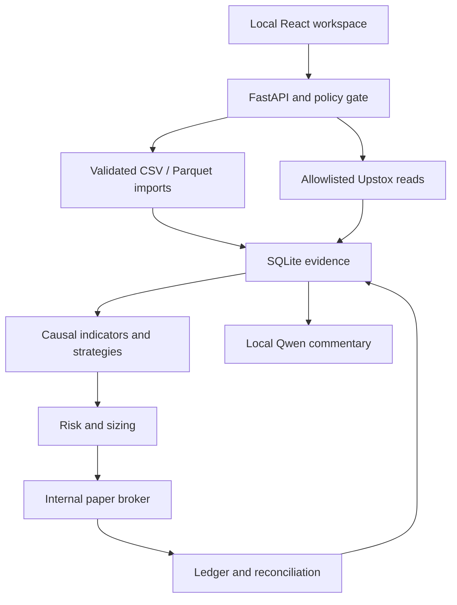
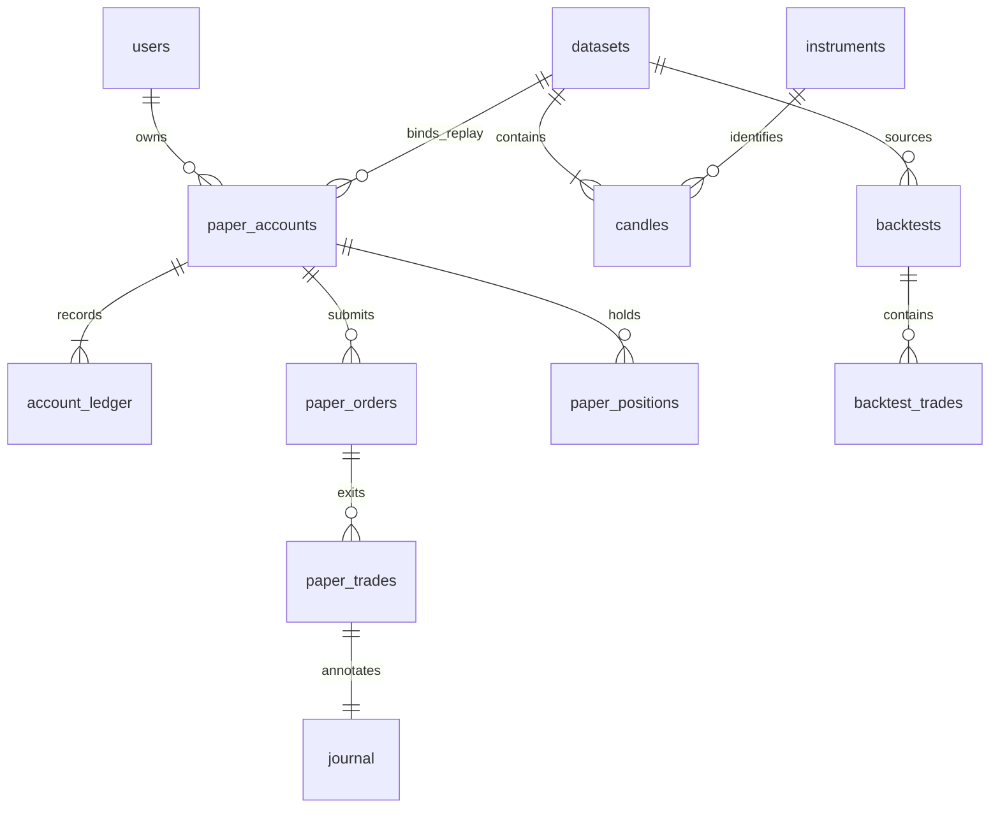

# System Architecture

## Boundaries

React/TypeScript communicates with a same-origin FastAPI server. SQLite is the only
financial store. The recommended runtime is one loopback-bound process with one
worker. No broker execution adapter exists. Optional network access is isolated in
`providers.py`; local AI is isolated in `ai.py` and receives read-only snapshots.

## Files and Responsibilities

| Path | Responsibility |
|---|---|
| `backend/app/core.py` | Data cutoff policy, UTC parsing, paise conversion |
| `backend/app/schema.sql`, `database.py` | DDL, indexes, SQLite WAL, transaction boundary |
| `backend/app/schemas.py` | Typed validated inputs, fee and risk contracts |
| `backend/app/data.py` | Atomic import, provenance, contract/price validation, as-of reads |
| `backend/app/providers.py` | Provider interface; CSV, SQLite and read-only Upstox |
| `backend/app/indicators.py` | Indicators, delayed-confirmation swings, deterministic regime |
| `backend/app/strategies.py` | Eleven separate strategy classes and registry |
| `backend/app/risk.py` | Common entry checks, whole-lot sizing, simulated charges |
| `backend/app/paper.py` | Accounts, orders, partial exits, stops, replay, ledger reconciliation |
| `backend/app/backtesting.py` | Isolated event-driven backtests, metrics and walk-forward |
| `backend/app/research.py` | Descriptive forward-outcome event studies |
| `backend/app/options.py` | Model Greeks, IV inversion, chain statistics and payoff analytics |
| `backend/app/ai.py` | Disabled provider and read-only local Qwen analysis |
| `backend/app/main.py` | API routes, local host/origin controls and static app hosting |
| `frontend/src/pages/` | Data, backtesting/research and options views |
| `frontend/src/App.tsx` | Dashboard, replay, portfolio, ledger, journal, risk and settings |
| `tests/`, `frontend/tests/` | Synthetic-only software fixtures and integration tests |

## Database and Relationships

`schema.sql` is the executable schema. The application stores timestamps in UTC and
renders market times in Asia/Kolkata. Monetary ledger values are integer paise.

`option_contracts` and `portfolio` are views to avoid duplicate financial state.
Indicator/regime/signal tables reserve persisted-analysis storage; the UI currently
computes these from visible candles on demand. Strategy parameter records are
embedded in each backtest snapshot. `quotes` preserves live fill evidence.
`data_quality`, `risk_events`, `alerts` and `ai_analysis_logs` provide audit context.
Instrument, expiry/strike/kind, candle as-of, ledger timestamp and chain lookup
indexes cover the principal queries. Foreign keys are always enabled.

## Account Invariants

Creation is explicit and deposits exactly the selected capital, default INR 1,000.
No startup account, recurring funding, reset or deposit endpoint exists. Initial
capital, mode and dataset identity cannot be updated. Each experiment is separate.

For long fully funded positions:

- Buy: cash decreases by observed price times quantity plus simulated costs.
- Sell: cash increases by proceeds minus simulated costs; gross realized P&L is
  proceeds minus allocated entry basis.
- Partial exits allocate integer basis and entry fees; the final exit consumes the
  exact remainder. This avoids cumulative rounding drift and double counted fees.
- Equity = cash + observed market value of remaining positions.
- Equity = initial capital + gross realized P&L + gross unrealized P&L - costs.
- Slippage is a disclosed cost component, not an invented market price. It is
  included in fees and reported separately for attribution, never deducted twice.

Reconciliation verifies event hashes, cash transitions, cumulative costs/P&L,
remaining cost basis and net quantities. A discrepancy permanently halts the account
without repairing the corrupted balance. SQL triggers reject ledger edits/deletion.
Hashes and triggers protect application-level integrity, not a hostile machine
administrator who can replace the entire database. Keep independent backups.

## Data and Time

Imports are all-or-nothing. Every timestamp must be timezone-aware. Candles require
valid positive OHLC, integer nonnegative volume, registered contract metadata and
tick alignment. Duplicates or overlapping imports reject without overwriting.
Missing intraday intervals and >15% gaps warn; they are not filled or repaired.
The file hash, source description and original candle identifiers remain available.

A candle becomes available only at its timestamp plus its timeframe. This is
conservative for daily and truncated session bars. Data ingestion does not constitute
a certified exchange-calendar validator. Official holidays, sessions and corporate
action adjustments remain operator/data-source responsibilities.

Replay uses the account's server-owned dataset/cursor/clock. Views include only
completed candles through that clock. Advancing processes the next recorded OPEN,
then publishes its completed candle. Signals use prefixes of indicator data; a
confirmed swing is exposed only after its right-hand confirmation bars exist.
No execution price parameter is exposed on the HTTP order endpoint.

## Execution and Risk

PaperBroker has no network dependency. The API obtains a validated provider quote
or a stored candle-open event and passes it to the internal broker. Live calls are
guarded by exchange status and freshness. Failed reads stop the polling operation;
no prior quote is reused as a current mark. Default live account reads show unknown
marks until a successful explicit poll.

Whole lots, affordability, stops, position count, percentage exposure, round-trip
cost-aware per-trade risk and daily entry/loss limits are checked on fills. Default
trade risk is 1%; default daily loss budget is a conservative 2% of INITIAL capital,
not a dynamically replenished daily allowance. Stop levels do not guarantee capped
losses through gaps. Pending orders do not reserve cash; affordability is reevaluated
sequentially at each fill. Risk-reducing SELL orders cannot create short exposure.

Market/limit orders, cancellation, limit modification, targets, trailing stops and
partial exits are implemented for fully funded long spot equities and long options.
In replay, stops/targets are tested at opens only; no invented intrabar path is used.
Trailing levels update from completed closes. No automatic expiry payout is inferred.

## Research

Backtests are independent from paper-account capital and run in memory with saved
results/parameters. They share sizing, charge and entry-risk helpers. Signals use
completed bars; next-open execution uses no current bar close/high/low/volume.
Open positions remain marked at the end and are not fabricated into closed trades.
Metrics distinguish closed-trade net results from total marked equity change.
Annualized Sharpe/Sortino require at least 20 observed sessions; undefined values
are null, including profit factor with no losses.

Walk-forward windows have disjoint train, validation and test segments within each
fold. Three ATR-stop candidates are selected on validation only; test performance
is shown separately. Each segment has independent warm-up and capital. Overlapping
training across folds is permitted; no claim of compounded OOS returns is made.

Research event studies deliberately measure later outcomes; these values are never
fed back into strategy inputs. Overlapping observations and small samples are
explicit limitations. Analytics are not evidence of causality or future profitability.

## Version 0.3 runtime additions

`runtime_api.py` exposes stream, automation, physical-delivery, activity and basket-job
controls. `streaming.py` owns a single V3 socket thread; `replay_worker.py` owns a
single optional background replay thread. Both serialize paper-account mutations
through the same process-wide RLock as manual execution. Browser activity polling
uses ordinary local-only HTTP; no publicly exposed inbound socket or credentials
are needed. All workers stop on application shutdown and do not auto-restart trading.

`automation.py` evaluates only the completed visible prefix, persists its decisions,
and submits idempotent paper orders. A separate signal-to-order boundary preserves
next-observation fills. Live bar histories are segmented on gaps and reconnects.
`basket_backtesting.py` snapshots SQLite into a temporary isolated DB and invokes
the same derivative broker against scheduled entry/exit horizons. Results alone
return to the primary DB; research accounts never enter its live account tables.

`delivery.py` transforms basket derivative positions into net stock/cash obligations
only after imported evidence is published and due. Append-only `BASKET_DELIVERY`
events contain the evidence IDs and resulting positions; reconciliation independently
replays the transformation. Cash inadequacy and share shortfalls create blocked
obligations without ledger mutations. There is no broker/depository interaction.

Schema version 3 adds rule/decision, stream-bar, activity, delivery and research-job
tables. See RUNTIME.md for assumptions and API-use workflows.

## Optional AI (unchanged)

Only fixed loopback Ollama or OpenAI-compatible local endpoints are used. No paid AI
service, arbitrary URL, SQL execution, function calls or model-generated market data
is accepted. Responses are untrusted commentary saved with a snapshot hash and model
name. Model failure has no effect on deterministic execution.

## Adaptive selection (0.4)

`adaptive.py` ranks bounded visible-prefix simulations and persists account-level
loss controls in `adaptive_state` (schema version 4). `automation.py` retains the
sole entry boundary through PaperBroker. Quantity caps apply to candidate research
and actual entries. Reconfiguration invalidates candidate rankings without erasing
cooldowns, reduced quantity caps or the adaptive equity drawdown halt.
